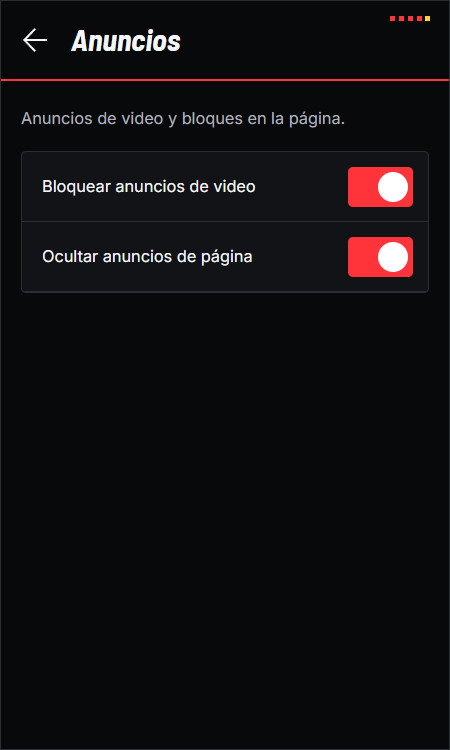
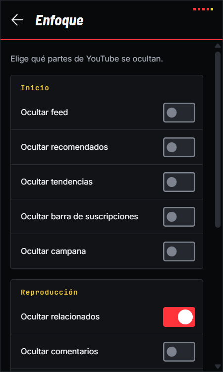

<div align="center">
  

  # Youtube Clean

  **Para ver YouTube sin el anuncio del medio y sin Shorts en el inicio.**

  Chrome, Edge y Firefox. Abres el icono, marcas lo que quieres quitar y recargas la pestaña.

  A Manifest V3 extension that skips YouTube ads, hides Shorts, and adds a focus mode.

  
  
  
  
  
  

  [Descargar](https://github.com/notnomoro/youtube-clean/releases) · [Reportar un problema](https://github.com/notnomoro/youtube-clean/issues) · [Instalación](docs/instalacion.md)

  <br>

  

</div>

---

## Qué hace

- Salta el anuncio del video y esconde los banners y los anuncios del feed.
- Si entras a un Short, lo abre como video normal. También puedes esconder la pestaña de Shorts y las tarjetas del inicio.
- En Enfoque puedes quitar el feed, los recomendados, los comentarios, el chat y la columna de la derecha, y evitar que YouTube ponga solo el siguiente video.
- Protección apaga todo de golpe. Lo que habías marcado se queda, por si lo vuelves a encender.

Lo que viene marcado al instalarla está en [Ajustes](docs/ajustes.md). Qué toca y qué no, en [Privacidad](docs/privacidad.md).

---

## Capturas

<div align="center">


<br><sub><b>Anuncios</b> · video y página</sub>

<br><br>

<table>
  <tr>
    <td width="33%"><br><sub><b>Shorts</b> · reproductor, pestaña y feed</sub></td>
    <td width="33%"><br><sub><b>Enfoque</b> · inicio, reproducción y diseño</sub></td>
    <td width="33%"><br><sub><b>YouTube</b> · extensión activa</sub></td>
  </tr>
</table>

</div>

---

## Empezar

### Descargar

En [Releases](https://github.com/notnomoro/youtube-clean/releases) hay dos zip: `youtube-clean-chrome.zip` (Chrome, Edge, Brave u Opera) y `youtube-clean-firefox.zip`. Se descomprime y se carga esa carpeta. El paso a paso está en [Instalación](docs/instalacion.md).

### Desde el código

No hay que compilar nada.

1. Clona el repositorio.
2. En Chrome, Edge, Brave u Opera, carga la carpeta `chrome/` como extensión descomprimida.
3. En Firefox 121+, carga `firefox/manifest.json` desde `about:debugging`.
4. Abre YouTube o recarga la pestaña.

```bash
git clone https://github.com/notnomoro/youtube-clean.git
cd youtube-clean
```

Para generar los zip en local:

```powershell
./scripts/package.ps1
```

---

## Construido con

| Área | Qué usa |
|---|---|
| Extensión | Manifest V3, sin empaquetador |
| Panel | HTML, CSS y JavaScript en `popup/` |
| YouTube | Content script en `document_start` y CSS según clases en `<html>` |
| Ajustes | `storage.sync` del navegador, clave `youtubeClean` |
| Chromium | Carpeta `chrome/` (`chrome.storage`) |
| Firefox | Carpeta `firefox/` (`browser.storage`, id `youtube-clean@extension.local`) |

Cómo encajan esas piezas: [Arquitectura](docs/arquitectura.md).

---

## Código abierto

Va bajo **MIT**. Puedes usarla, cambiarla y pasársela a quien quieras. Si la copias, deja el aviso de copyright.

- Si algo falla, abre un [issue](https://github.com/notnomoro/youtube-clean/issues) y di el navegador y qué estabas haciendo.
- Si echas en falta un ajuste, el issue también sirve.
- Si vas a tocar el código, mira [Contribuir](CONTRIBUTING.md).

### Inspiración

No salió de cero. Cada parte se apoya en una extensión que ya hacía bien una cosa, y aquí quedan juntas en el mismo panel.

| Proyecto | Qué aporta aquí |
|---|---|
| [Youtube-shorts-block](https://github.com/doma-itachi/Youtube-shorts-block) | Abrir los Shorts en el reproductor normal. MIT, © 2022 土間いたち. |
| [distraction-free-youtube-chrome-extension](https://github.com/adrianbartnik/distraction-free-youtube-chrome-extension) | Esconder feed, comentarios, notificaciones y lo demás que distrae, y apagar la reproducción automática. Es el DF Tube de [calkuta](https://chromewebstore.google.com/detail/df-tube-distraction-free/mjdepdfccjgcndkmemponafgioodelna), pasado a Manifest V3. |
| [Youtube-AdBlocker](https://github.com/kananinirav/Youtube-AdBlocker) | Saltar el anuncio del reproductor y esconder los de la página. MIT, © 2022 kananinirav. |

---

## Licencia

**MIT**. El texto está en [LICENSE](LICENSE).

Las fuentes del panel (Inter, Barlow Semi Condensed y JetBrains Mono) van con la [SIL Open Font License 1.1](https://openfontlicense.org/).

<div align="center">
<sub><a href="https://notnomoro.github.io">notnomoro.github.io</a> · <a href="https://www.youtube.com/@notnomoro">YouTube</a> · <a href="https://x.com/nomorooo/">X</a></sub>
</div>
