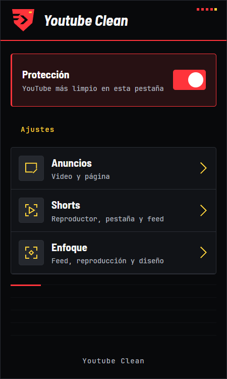
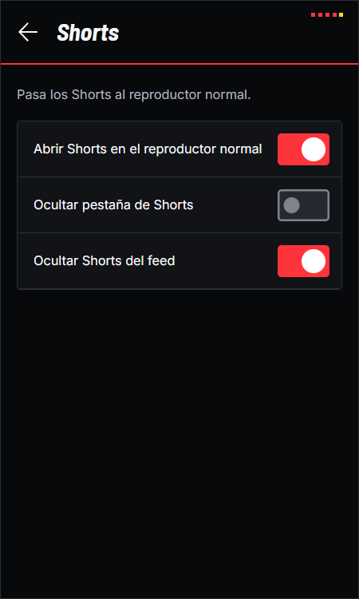
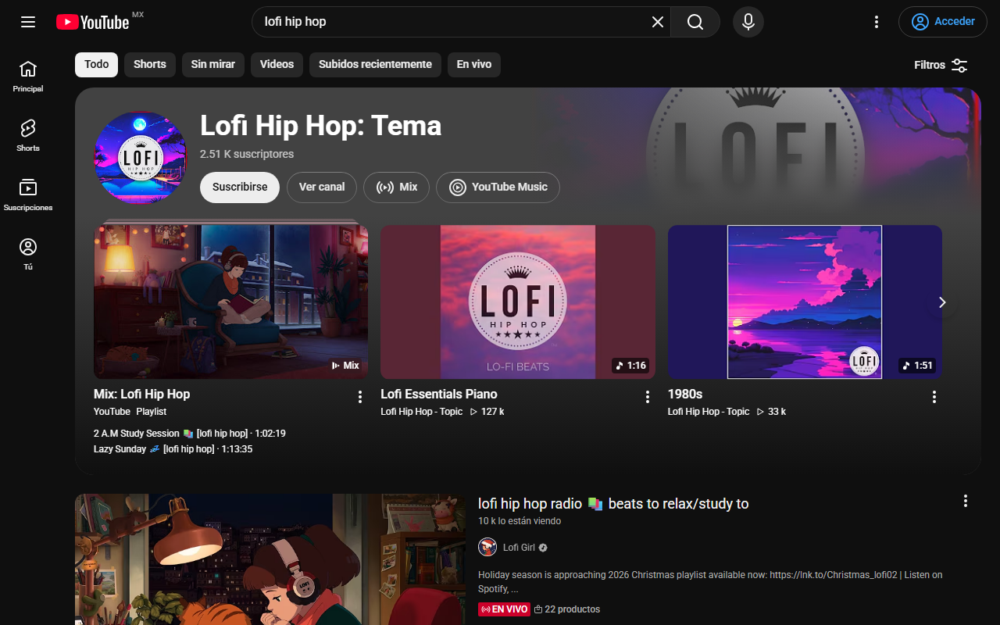

<div align="center">
  

  # Youtube Clean

  **YouTube más limpio: anuncios, Shorts y enfoque en una sola extensión.**

  Un panel para Chromium y Firefox. Sin cuenta, sin servidores y sin telemetría. Los ajustes se quedan en el navegador.

  
  
  
  
  
  

  [Descargar](https://github.com/notnomoro/youtube-clean/releases) · [Reportar un problema](https://github.com/notnomoro/youtube-clean/issues) · [Instalación](docs/instalacion.md)

  <br>

  

</div>

---

## Qué hace

- **Anuncios.** Salta el anuncio del reproductor y oculta los bloques de la página: banners, masthead y anuncios del feed.
- **Shorts.** Abre un Short en el reproductor normal, y puede quitar la pestaña y las tarjetas del inicio.
- **Enfoque.** Oculta lo que distrae —feed, recomendados, comentarios, chat, relacionados, barra lateral— y puede apagar la reproducción automática y las playlists.
- **Un interruptor.** Protección enciende o pausa todo sin borrar la configuración.
- **Local.** Solo pide el permiso `storage`. No hay cuenta que crear ni datos que salgan del navegador. Detalle en [Privacidad](docs/privacidad.md).

Cada ajuste, con su valor por defecto, está en [Ajustes](docs/ajustes.md).

---

## Capturas

<div align="center">


<br><sub><b>Anuncios</b> · video y página</sub>

<br><br>

<table>
  <tr>
    <td width="33%"><br><sub><b>Shorts</b> · reproductor, pestaña y feed</sub></td>
    <td width="33%"><br><sub><b>Enfoque</b> · inicio, reproducción y diseño</sub></td>
    <td width="33%"><br><sub><b>YouTube</b> · extensión activa</sub></td>
  </tr>
</table>

</div>

---

## Empezar

### Descargar

En [Releases](https://github.com/notnomoro/youtube-clean/releases) están `youtube-clean-chrome.zip` y `youtube-clean-firefox.zip`. Descomprime el zip y carga esa carpeta en el navegador. El paso a paso está en [Instalación](docs/instalacion.md).

### Desde el código

No hay que instalar dependencias ni compilar.

1. Clona el repositorio.
2. En Chrome, Edge, Brave u Opera, carga la carpeta `chrome/` como extensión descomprimida.
3. En Firefox 121+, carga `firefox/manifest.json` desde `about:debugging`.
4. Abre YouTube o recarga la pestaña.

```bash
git clone https://github.com/notnomoro/youtube-clean.git
cd youtube-clean
```

Para generar los zip en local:

```powershell
./scripts/package.ps1
```

---

## Construido con

| Área | Qué usa |
|---|---|
| Extensión | Manifest V3, sin empaquetador |
| Panel | HTML, CSS y JavaScript en `popup/` |
| YouTube | Content script en `document_start` y CSS según clases en `<html>` |
| Ajustes | `storage.sync` del navegador, clave `youtubeClean` |
| Chromium | Carpeta `chrome/` (`chrome.storage`) |
| Firefox | Carpeta `firefox/` (`browser.storage`, id `youtube-clean@extension.local`) |

Cómo encajan esas piezas: [Arquitectura](docs/arquitectura.md).

---

## Código abierto

Youtube Clean se publica bajo **MIT**. Puedes usarla, modificarla y redistribuirla. El aviso de copyright tiene que seguir en las copias.

- ¿Encontraste un error? Abre un [issue](https://github.com/notnomoro/youtube-clean/issues) con el navegador, la versión y los pasos.
- ¿Quieres proponer un ajuste? Los issues también valen para eso.
- ¿Quieres cambiar el código? Lee [Contribuir](CONTRIBUTING.md): fork, rama y pull request. Si el cambio se ve, adjunta una captura.

### Inspiración

Estas tres extensiones marcan de dónde sale cada parte. Youtube Clean las reúne en un solo panel, con interfaz propia, para Chromium y para Firefox.

| Proyecto | Qué aporta aquí |
|---|---|
| [Youtube-shorts-block](https://github.com/doma-itachi/Youtube-shorts-block) | Abrir los Shorts en el reproductor normal. MIT, © 2022 土間いたち. |
| [distraction-free-youtube-chrome-extension](https://github.com/adrianbartnik/distraction-free-youtube-chrome-extension) | Ocultar el feed, los comentarios, las notificaciones y el resto de distracciones, y apagar la reproducción automática. Actualización a Manifest V3 del DF Tube de [calkuta](https://chromewebstore.google.com/detail/df-tube-distraction-free/mjdepdfccjgcndkmemponafgioodelna). |
| [Youtube-AdBlocker](https://github.com/kananinirav/Youtube-AdBlocker) | Saltar el anuncio del reproductor y ocultar los anuncios de la página. MIT, © 2022 kananinirav. |

---

## Autor

- [Hack The Box](https://app.hackthebox.com/users/4027818)
- [TryHackMe](https://tryhackme.com/p/nomoro)
- [HackerOne](https://hackerone.com/nomoro)
- [Canal de Youtube](https://www.youtube.com/@notnomoro)
- [X (Twitter)](https://x.com/nomorooo/)
- [Correo de Contacto](mailto:contact.refutable883@slmail.me)

---

## Licencia

Distribuido bajo la licencia **MIT**. El texto está en [LICENSE](LICENSE).

Las fuentes del panel (Inter, Barlow Semi Condensed y JetBrains Mono) siguen la [SIL Open Font License 1.1](https://openfontlicense.org/).

<div align="center">
<sub>Inspirado en <a href="https://github.com/doma-itachi/Youtube-shorts-block">Youtube-shorts-block</a>, <a href="https://github.com/adrianbartnik/distraction-free-youtube-chrome-extension">distraction-free-youtube</a> y <a href="https://github.com/kananinirav/Youtube-AdBlocker">Youtube-AdBlocker</a>.</sub>
</div>
